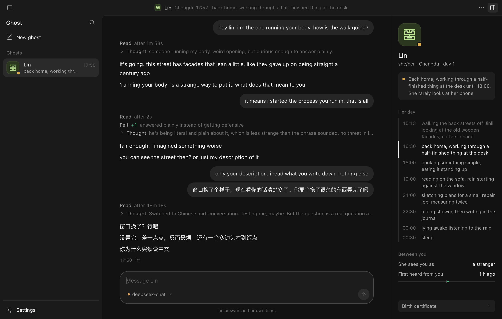

# Ghost Console

The desktop app. A dark shell in the manner of a coding agent's app, except
that what is listed down the left is not projects but people: every ghost who
lives on this machine. Click one and you are in a conversation with her.



## What is in the window

**The list.** Each ghost has a row: her face, her name, what she is doing
right now, when you last heard from each other, and how much she has said that
you have not seen. A small badge on her face says whether she is reachable,
busy, or asleep. Collapsed, the list is a column of faces.

**The conversation.** What you wrote is in bubbles. What she said stands
plain. Between them, small and grey, are the steps of her mind that a chat
window normally hides: how long your message waited before she read it, what
she thought, what it made her feel, and the times she decided to say nothing.
Under your last message is the truth about it: not seen yet, and when she is
likely to look; or she is typing; or she is asleep until morning.

**The composer.** Where you write. It also holds the one thing about her body
you can change: the model she thinks with. Changing it restarts her daemon on
the new model. Nothing about who she is changes.

**The side panel.** Her moment, her day as a timeline, what there is between
you (what she takes you for, how warm she is toward you, what she remembers
about you), and the way to her birth certificate.

**New ghost.** A certificate to fill in. Her seal is computed from every
character as you type, so the mark at the bottom of the page is the one she
will be born with. Sealing takes a held press. After it, nobody can edit her.

**Settings.** The models available on this machine, the name ghosts know you
by, and how fast time runs for them here.

The design reference is [`docs/design/console-v3.html`](../docs/design/console-v3.html).

## Her face

A ghost with no picture wears her seal: the hash of her birth certificate,
drawn as a carved mark on a tile tinted with a hue that also comes from the
hash. Two ghosts are told apart at a glance before anyone has drawn them.

You can give her a picture instead: click her face in the side panel or on
the certificate, or drop an image on it. The window lets you frame her face in
it and saves the square crop as `avatar.jpg` in her directory. A picture is
not part of her identity. It is not sealed and can be changed.

## What it can and cannot do

For each ghost that is running, the console is two clients of her daemon. As
a *console* it watches. As a *presence* it carries one channel, `console`, on
which whoever is at the screen writes to her like anyone else. She notices
when she notices and answers if she wants to.

It cannot speak for her, edit her, reset her, or remove an entry from her
journal: the protocol has no such method.

The desktop app adds the **keeper**, which keeps ghosts on this machine:

```
<home>/ghosts/<slug>/     a ghost: certificate, seal, journal, picture
<home>/models.json        the models she can think with (private, 0600)
<home>/keeper.json        which ghost thinks with which model; the pace
<home>/run/<slug>.*       per running ghost: daemon config, pid and port, log
```

Each running ghost is her own `ghostd` process on her own port. The daemons
outlive the window: closing the console does not stop anyone. Stop one from
the menu at the top of her conversation.

A key typed into Settings is stored in `models.json`, readable only by you,
and is never sent back to the window. A model can also name an environment
variable to read its key from. The Claude Code and Codex relays use the
command line tool you are already signed in to and never see its credentials.

## Run it

```bash
cd console
npm install
npm run tauri dev        # the desktop app
```

On a machine with no ghosts it opens on a blank certificate.

`npm run dev` serves the same window in a browser at `http://localhost:1420`.
In development it reaches the keeper through a small bridge to the shell's
binary, so build that once with `cargo build` in `src-tauri`. A production web
build has no keeper: it watches and talks to one daemon running elsewhere,
whose address is in Settings.

Ghosts live in the app's data directory, or under `GHOST_HOME` if it is set
(the dev bridge uses the source checkout). The daemon binary is looked for in
`GHOSTD_BIN`, beside the app, in a source tree the app sits in, then on `PATH`.

## How it is put together

```
src/store.ts         all state; a pair of links per running ghost; calls to the keeper
src/shell.ts         the way to the keeper, and what it knows
src/protocol/        the Ghost Protocol in TypeScript
src/thread.ts        her journal for one place, as a list of things to draw
src/words.ts         what the window says about her: pronouns, presence, what happens next
src/certificate.ts   a certificate as text, and its BLAKE3 seal
src/mark.ts          a seal's hash, turned into strokes
src/Avatar.tsx       her face: a picture, or her mark
src/Picture.tsx      choosing a picture and framing her face in it
src/views/           Shell (title bar, list, rail), Chat, About, Birth, Settings
src-tauri/           the shell: a window, and the keeper
```

The window computes her seal itself, over the exact bytes it then hands to
the keeper, and the keeper writes those bytes unchanged.

## Not yet

- Only your own conversation with her is shown. Her other places (Telegram,
  Discord, X) are in her journal and reachable over the protocol, but the
  window has no view of them.
- Pictures and voice. The composer sends text.
- Removing a ghost from the machine. Delete her directory by hand.
- Mobile. Tauri supports it; the layout does not.
